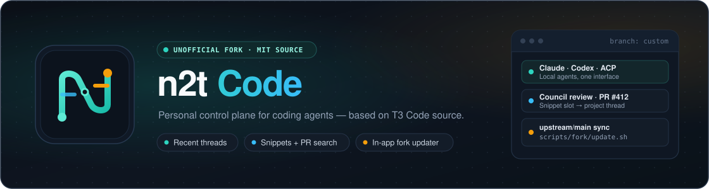
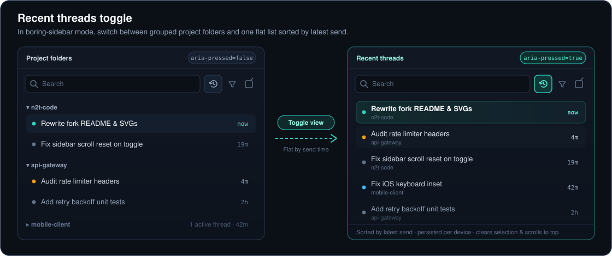
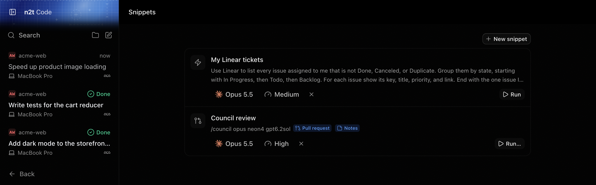
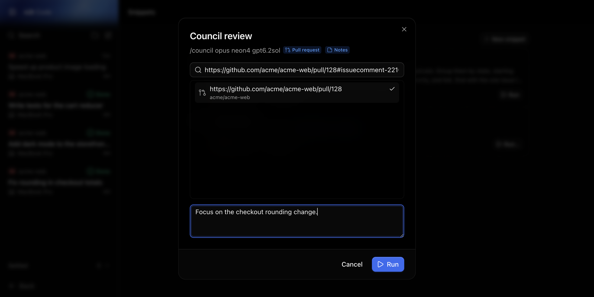
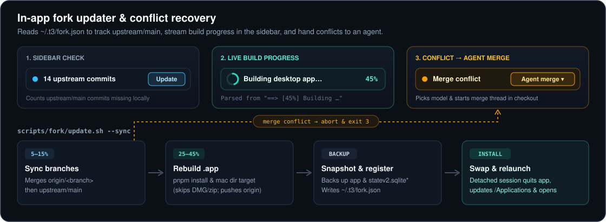

<p align="center">
  
</p>

<h1 align="center">n2t Code</h1>

<p align="center">
  An unofficial fork based on the <a href="https://github.com/pingdotgg/t3code">T3 Code</a> source code.
</p>

<p align="center">
  <a href="#what-this-fork-adds"><strong>Fork features</strong></a> ·
  <a href="#install--update-this-fork">Install &amp; update</a> ·
  <a href="#run-from-source">Run from source</a> ·
  <a href="./docs/README.md">Docs</a> ·
  <a href="https://github.com/pingdotgg/t3code">Upstream</a>
</p>

> [!IMPORTANT]
> **Unofficial fork:** **n2t Code** ([`tinwritescode/n2t-code`](https://github.com/tinwritescode/n2t-code)) is a personal, unofficial fork based on the T3 Code source code. It is **not** affiliated with, endorsed by, or maintained by T3 Tools, Inc. See [Trademarks](#trademarks) and [`TRADEMARK.md`](./TRADEMARK.md).

**n2t Code** runs the coding agents already installed on your machine and gives them one fast interface across desktop, web, and remote sessions. Start a thread at your desk, review diffs, or approve the next step from another device.

It works with Claude Code, Codex, Cursor, OpenCode, Grok Build, Antigravity, Kiro, Pi, Muse Code, fx, and any [ACP](./docs/user/providers-acp.md) agent. If an agent CLI is set up on your computer, n2t Code can drive it.

## What you get

- **Your subscriptions.** n2t Code does not resell tokens. It drives the coding agents you are already signed in to.
- **Every agent in one place.** Switch models in the middle of a thread or hand work between agents.
- **Desktop, web, and remote ready.** Run one server and connect locally, over your network, or over Tailscale (see [remote access](./docs/user/remote-access.md)).
- **Git built in.** Give each thread its own worktree, inspect diffs, and commit, push, or open pull requests directly from the app.
- **Open source.** The source code is MIT licensed under [`LICENSE`](./LICENSE).

## What this fork adds

### Recent threads view (boring sidebar)

<p align="center">
  
</p>

- Adds a **Recent threads** toggle button (History icon) to the sidebar header when boring-sidebar mode is enabled.
- Swaps grouped project folders for one flat list of active threads sorted by latest send; clicking it again restores the folder view.
- Persists your view choice per device, hides when there are no projects, and clears selection while scrolling back to the top when switching views.

### Snippets with live pull request search

<p align="center">
  
</p>

<p align="center">
  
</p>

- **Saved prompts everywhere.** Manage reusable prompts in client settings, each with its own model override (or set to follow the current thread's model). Run them as a side chat from the **Snippets** tab in the right panel, or launch a fresh thread from the **Snippets** page next to Pull requests in the sidebar.
- **Interactive slots & PR search.** Prompts containing `{{pr}}` or `{{notes}}` display those placeholders as structured slots and open a run dialog (`Run…`) before starting. Typing in the pull request search box narrows loaded open pull requests immediately and queries the host after a 250 ms pause to reach pull requests beyond the first page. Running a PR snippet starts the thread in that pull request's project.
- **Thinking level per snippet.** Next to a snippet's model, pick its thinking level (for example Low, Medium, or High). It is saved with the snippet and used on every run.
- **Paste a pull request link.** Paste any GitHub pull request URL, even one pointing at a comment or a files tab, or type `owner/repo#123`, and the run dialog resolves it to that pull request.
- **Built-in defaults.** Ships with **My Linear tickets** and **Council review** snippets out of the box, with hover/focus edit and delete controls.

### Sidebar page shortcuts

Open the sidebar's pages without the mouse. Each key matches the button's position, and the button tooltips show it.

| Page          | macOS         | Windows / Linux  |
| ------------- | ------------- | ---------------- |
| Settings      | <kbd>⌃1</kbd> | <kbd>Alt+1</kbd> |
| Pull requests | <kbd>⌃2</kbd> | <kbd>Alt+2</kbd> |
| Snippets      | <kbd>⌃3</kbd> | <kbd>Alt+3</kbd> |
| Issues        | <kbd>⌃4</kbd> | <kbd>Alt+4</kbd> |
| Usage         | <kbd>⌃5</kbd> | <kbd>Alt+5</kbd> |

Rebind them in **Settings → Keybindings**.

### In-app fork updater & upstream sync

<p align="center">
  
</p>

- **Updates from your checkout.** When a packaged build finds `~/.t3/fork.json`, it checks how many commits `upstream/main` is ahead of your branch and rebuilds through [`scripts/fork/update.sh`](./scripts/fork/update.sh) instead of pulling from an external release feed.
- **Sidebar progress readout.** Streams step percentages from the update script directly into the sidebar update indicator as a progress ring and percent label.
- **Agent-assisted conflict resolution.** When a synced merge conflicts, the script aborts cleanly (exit code `3`) and the sidebar update button turns into a merge button with a model picker, starting an agent thread in your fork checkout to resolve the conflict, rebuild, and reinstall.
- **Daily upstream sync PR.** [`.github/workflows/sync-upstream.yml`](./.github/workflows/sync-upstream.yml) opens a daily pull request syncing `pingdotgg/t3code:main` into `custom` whenever upstream has new commits.

## Install / update this fork

### Prerequisites

- Node.js and `pnpm` (see [first checkout](./docs/operations/00_development.md#first-checkout))
- At least one coding agent installed and signed in — for example, [Claude Code](https://claude.com/product/claude-code) (`claude auth login`) or [Codex CLI](https://developers.openai.com/codex/cli) (`codex login`). See [provider setup](./docs/user/install.md#providers) for the full list.

### Clone and configure remotes

```bash
git clone https://github.com/tinwritescode/n2t-code.git
cd n2t-code
git remote add upstream https://github.com/pingdotgg/t3code.git
```

### Build and install on macOS

Use [`scripts/fork/update.sh`](./scripts/fork/update.sh) to build the desktop `.app` (using the `dir` target to skip slow DMG/zip packaging), swap it into `/Applications`, and relaunch:

```bash
# Build the current checkout, install into /Applications, and relaunch
./scripts/fork/update.sh

# Merge origin/<branch> and upstream/main first, rebuild, push to origin, and install
./scripts/fork/update.sh --sync

# Build only and print the resulting .app path
./scripts/fork/update.sh --no-install

# Install the last build without rebuilding
./scripts/fork/update.sh --install-only
```

Notes on how the installer behaves:

- Installing writes `~/.t3/fork.json` with your checkout path and branch so the packaged app can update itself from the sidebar.
- Each install moves the replaced `.app` and copies `statev2.sqlite*` into timestamped backups under `~/.t3/fork-backup`.
- The swap runs in its own detached session so quitting and relaunching works even when triggered from the app's own terminal.
- `--sync` aborts any conflicted merge and exits with code `3` so you can resolve it manually (or via the in-app agent merge button) and rerun without `--sync`.

## Run from source

To run the web and server dev environment locally without packaging a desktop build, follow the [development runbook](./docs/operations/00_development.md#first-checkout).

## Documentation

- [Install and first run](./docs/user/install.md)
- [Remote access from another device](./docs/user/remote-access.md)
- [Permission modes](./docs/user/permission-modes.md)
- [Source control](./docs/user/source-control.md)
- [Connect outside agents over MCP](./docs/user/outside-agents.md)
- [Architecture overview](./docs/internals/01_architecture.md)
- [All docs](./docs/README.md)

## License

The source code in this repository is licensed under the [MIT License](./LICENSE). The MIT License applies **only to the source code**.

## Trademarks

This project is an unofficial fork based on the [T3 Code](https://github.com/pingdotgg/t3code) source code and is **not** affiliated with, endorsed by, or maintained by T3 Tools, Inc.

The MIT License does not grant any rights to T3 Tools, Inc.'s trademarks, service marks, trade names, trade dress, or branding (including the T3 Code name, wordmarks, logos, and icons). See [`TRADEMARK.md`](./TRADEMARK.md) for the upstream trademark and branding policy.
